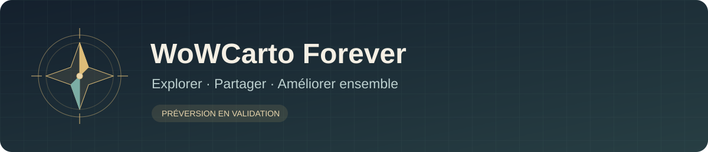

# WoWCarto Forever

**A community Windows cartographer for WoW Forever.**

[Français](README.md) · [Validation status](docs/STATUS.md) · [Build guide](docs/BUILD.md)

WoWCarto Forever is a new application inspired by WoWCartographe 1.20. It
combines a continuous map, minimap, geographic region list, filtering, search
and annotations. The aim is to help the community explore and improve shared
map information for WoW Forever.

The client supports French and English historical databases, light and dark
themes, local annotation editing with revision history, and HTTPS community
synchronization. Compatible new French notes can be shared from the map.
Community annotations can be corrected; historical reference corrections
currently change names only.

**This is a validation preview, not a final release.** The local Windows package
has been exercised with isolated profiles, and the current local test suite
passed 232 tests. Public CI results are tracked separately.

Modern mode uses locally extracted Forever textures with projected historical
annotations. In-game alignment and seams remain under review. Legacy is an
explicit candidate using a candidate 1.08b database and mixed map resources;
one tile is missing. Exact original icon visibility rules and additional
translations are still unfinished.

Game textures, historical executables and original databases are not included.
A prepared local `data` directory is required. See the [French build guide](docs/BUILD.md)
for setup and packaging instructions, and [CONTRIBUTING](CONTRIBUTING.md) for
the community workflow. Contributions are public: do not submit personal data.

This independent community project does not claim official affiliation with
Blizzard, WoWCartographe's authors or the WoW Forever team. See [NOTICE](NOTICE.md).
