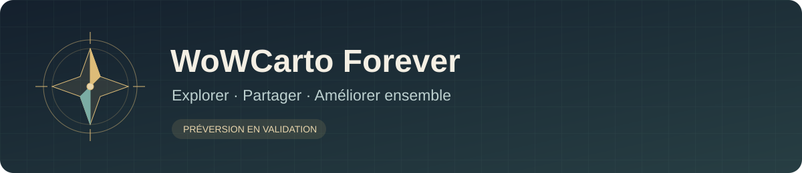

# WoWCarto Forever

**Un cartographe Windows communautaire pour explorer WoW Forever et faire vivre ses annotations.**

[Présentation en anglais](README.en.md) · [État du logiciel](docs/STATUS.md) · [Installation et compilation](docs/BUILD.md) · [Contribuer](CONTRIBUTING.md)

WoWCarto Forever est une nouvelle application inspirée de WoWCartographe 1.20.
Elle reprend son organisation visuelle : carte centrale, minicarte, liste de
zones géographiques, filtre, recherche et annotations. Son objectif est de
permettre à la communauté de consulter, enrichir et corriger les informations
cartographiques pour WoW Forever.

## Ce qui fonctionne

- Carte continue avec déplacement, zoom, sélection des zones et contours.
- Recherche dans les noms et commentaires, avec filtres et résultats paginés.
- Bases historiques FR et EN, avec séparation des annotations personnelles.
- Thème clair ou sombre et interface française ou anglaise.
- Édition locale avec historique, import/export, masquage et restauration.
- Réception communautaire HTTPS, cache local et contrôle des révisions.
- Partage direct de nouvelles notes FR compatibles ; correction des annotations
  communautaires et des noms historiques.

## Trois modes, un état clairement annoncé

| Mode | Contenu | État |
| --- | --- | --- |
| Référence 1.20 | Cartes et annotations historiques FR/EN | Consultation et édition locale disponibles avec des ressources préparées |
| Modern | Textures locales de Forever 1.60.1.70755 et annotations historiques recalées | Raccords et positions à vérifier dans le jeu |
| Legacy candidat | Base candidate 1.08b, plans statiques et fonds continentaux 1.20 | Lecture et recherche disponibles ; provenance mixte et une image absente |

**Ce dépôt est une préversion en validation.** Il ne propose pas encore de
version finale ni d'installateur public. Le dernier paquet Windows local a été
essayé avec un profil isolé ; la suite locale a exécuté **232 tests avec succès**.
Les résultats locaux ne garantissent pas les résultats de la CI ou de toutes
les installations. Voir le [détail de validation](docs/STATUS.md).

## Installer ou développer

Le dépôt contient le code du client, les outils de préparation, les tests et le
service communautaire PHP/MySQL. **Les cartes, textures du jeu, exécutables
historiques et bases `master.loc` ne sont pas distribués ici.** Le client a
besoin d'un dossier de ressources préparé et vérifié.

```powershell
py -3.11 -m venv .venv
.\.venv\Scripts\python.exe -m pip install -r requirements.txt
.\.venv\Scripts\python.exe -m tools.clone_app --data "C:\chemin\vers\data"
```

Le dossier `data` doit contenir un `catalog.json` au format
`wcf-clone-catalog-v1` et les fichiers qu'il référence. Le
[guide technique](docs/BUILD.md) décrit la structure et les limites actuelles
de préparation. Un simple clonage du dépôt ne fournit pas les ressources du jeu.

## Un projet fait pour évoluer avec sa communauté

Les informations historiques peuvent être anciennes ou erronées. Les
contributions servent à les améliorer progressivement ; leur présence n'est
pas une garantie d'exactitude dans Forever. Une publication rend son contenu
visible aux autres utilisateurs. N'envoyez pas d'informations personnelles.

Le mode édition doit être activé et la base autorisée doit correspondre à la
base consultée. Une correction concurrente périmée est refusée. Le nom d'une
annotation historique peut être corrigé sans réécrire son fichier source.
Le [guide de contribution](CONTRIBUTING.md) détaille ces parcours et les limites
du format historique.

Pour signaler une position incorrecte ou un défaut visuel, ouvrez une issue en
précisant le mode, la langue, la zone et les étapes de reproduction. Les idées,
corrections de code et traductions sont également les bienvenues.

## Ressources et attribution

Projet communautaire indépendant, sans affiliation officielle annoncée avec
Blizzard Entertainment, les auteurs de WoWCartographe ou l'équipe WoW Forever.
Les noms et ressources de tiers restent la propriété de leurs titulaires.
La visibilité publique du code n'accorde aucune licence sur ces ressources.
Consultez [NOTICE](NOTICE.md) pour le périmètre de distribution et de licence.
